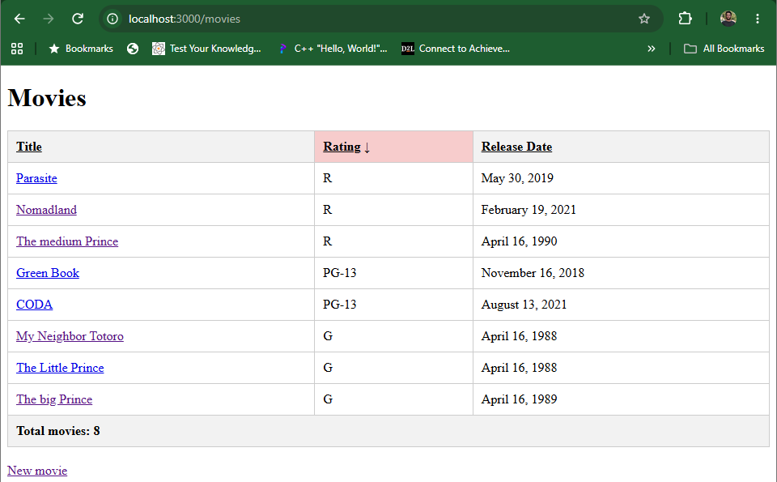
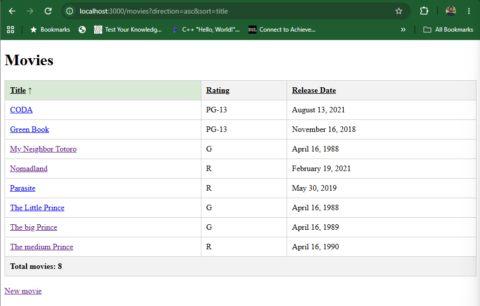
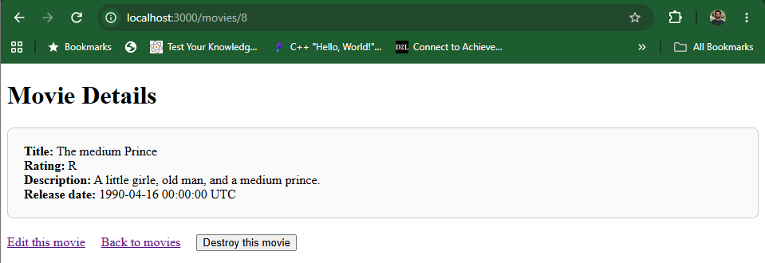
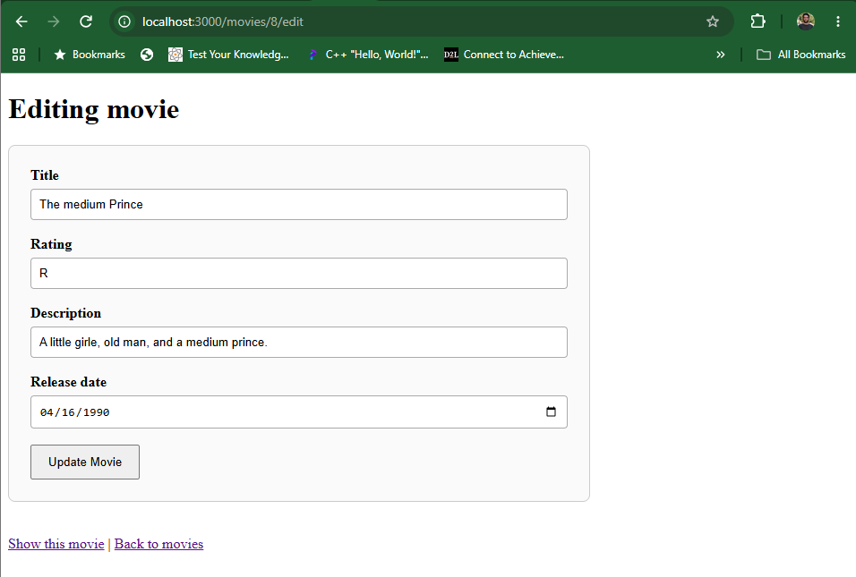
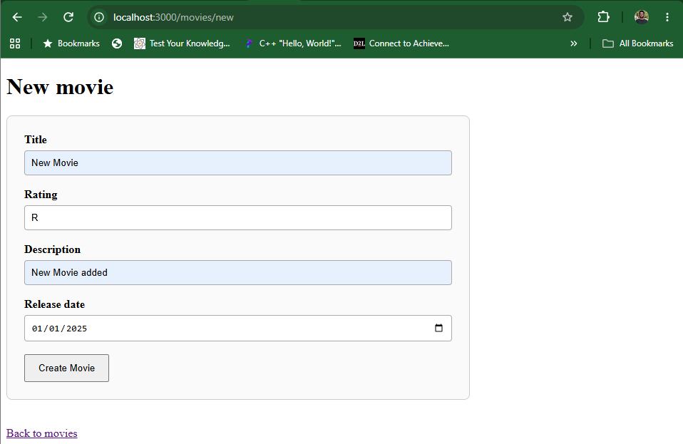
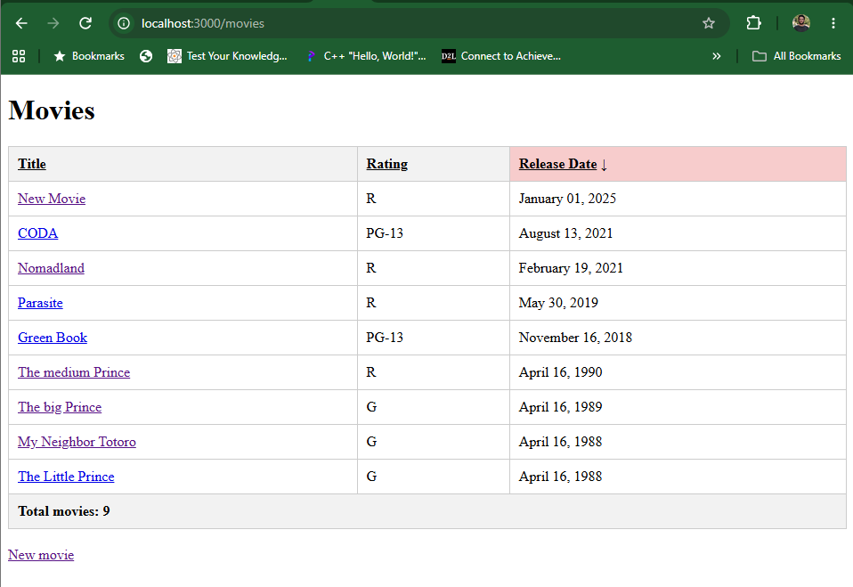
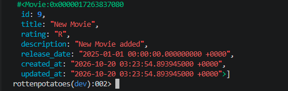

# README

This README would normally document whatever steps are necessary to get the
application up and running.

Things you may want to cover:

* Ruby version
4.0.6
I couldn't download Heroku due to access issues on my computer.
Below are screenshots of my work: 
Asc and Desc Sorting:

